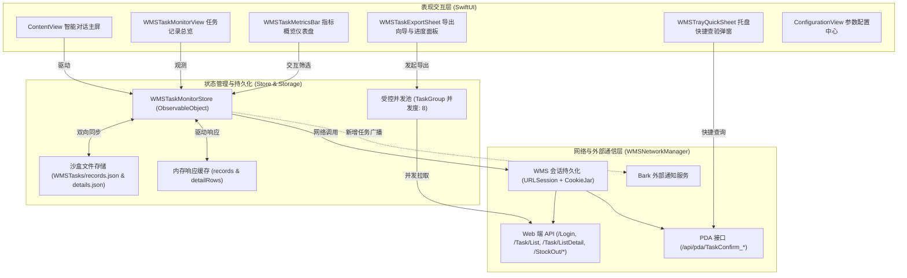

# WMSStockOutiOS 系统设计、架构方案与交接文档 (HANDOFF)

> **版本**：v1.1 (iOS 18.0+)  
> **更新时间**：2026-11-14  
> **工程目录**：`CPGROUP/WMS/WMS-IOS/`  
> **核心组件**：`WMS 1.0/ContentView.swift`、`WMS 1.0/WMSNetworkManager.swift`、`WMSStockOutiOS.xcodeproj`、`build_ipa.sh`

---

## 一、 项目背景与业务目标

本项目是面向仓储物流日常作业（出库领料、托盘查询、任务追踪与数据复盘）的原生 iOS 移动端客户端，旨在将原 Python 自动化脚本与 PC 网页端高频作业迁移至移动手持设备。

### 核心业务目标：
1. **智能交互出库**：支持物料名称、规格、重量及托盘号的多模式识别，提供生产领料流转与 **PDA 托盘实际出库二次确认 (`OutTaskConfirm`)** 全闭环。
2. **实时任务监控**：近实时监听 WMS 服务端出库与入库任务，提供前台增量轮询与本地长效历史档案记录。
3. **高效明细查验**：一键快捷查验托盘 PDA 任务，提供下钻至批号、件数、重量、坏包与质检状态的物料明细，并支持直接提交出库。
4. **极致性能导出**：突破旧版本串行导出的卡顿瓶颈，支持受控并发预加载，提供「秒级极速导出」与「多线程完整导出」双模式，兼容 Excel (.xls) 与 Universal CSV (.csv)。
5. **独立固化桌面图标**：工程与打包管线内置 1024x1024 蓝成立体扫码仓储专用图标，多分辨率生成并固化至安装包。

---

## 二、 整体系统架构设计

系统遵循现代 SwiftUI 的响应式与声明式架构规范，分为 **表现交互层 (View Layer)**、**状态与存储管理层 (Store & Storage Layer)** 以及 **网络与通信服务层 (Network & Services Layer)**。

### 2.1 架构分层流程图



---

## 三、 核心模块设计与关键技术演进

### 3.1 导出引擎与性能优化（提速 8~10 倍 + 秒级极速模式）

#### 痛点破除：
* **旧版缺陷**：在导出时使用串行 `for ... in` 循环单线程请求 `/Task/ListDetail`。若导出 100 条任务，在平均接口响应 300~500ms 的情况下，导出等待长达 30~50 秒。且只要单条失败，整个导出中断报错。
* **技术重构方案**：
  1. **结构化并发 (`TaskGroup`) 受控并发池**：通过动态迭代器种子填充与 `while await group.next()` 消费，维持固定 8 路管道高并发拉取未缓存的明细，将耗时压缩至 2~3 秒内。
  2. **双模式导出**：
     * ⚡️ **极速模式 (Summary Only)**：针对仅需任务编号、主单号、托盘号、库位、状态的操作员需求，直接导出内存及持久化缓存，**0.1 秒秒出，零网络请求**。
     * 📋 **完整明细模式 (Full Details)**：并发拉取缺失明细，动态提取所有物料字段与扩展业务字段。
  3. **容错降级保证**：针对个别超时或主单号异常的任务，不中断整体导出，填充 `[明细获取失败: 原因]` 占位提示，并在导出完成后展示异常摘要统计。
  4. **双格式支持**：
     * **Excel 2003 XML (.xls)**：支持表头高亮样式、斑马纹隔行变色及 XML 字符实体转义。
     * **通用 CSV (.csv)**：内置 `\u{FEFF}` (UTF-8 BOM)，杜绝 Windows Excel 与移动端 Numbers 中文乱码。

### 3.2 任务监控与数据中枢 (`WMSTaskMonitorStore`)

* **持久化演进**：旧版本将大量原始 JSON 数组直接存入 `UserDefaults`，数据量累积数千条时易造成应用启动阻塞与主线程卡顿。重构后迁移至 App 沙盒专属存储目录（`Documents/WMSTasks/records.json` 和 `details.json`），并在 `init()` 时实现**无感知自动平滑迁移**，兼顾向下兼容与高性能。
* **增量与全量双通道同步**：
  * **启动全量回溯**：冷启动时回溯拉取近 90 天记录，自动根据最新服务器状态更新本地未完成任务的生命周期。
  * **前台增量轮询**：每 30 秒仅以 `lastSyncKey` 为同步锚点查询新增任务，防止对服务器造成全量冲击。

### 3.3 交互体验完善

* **任务概览仪表盘 (`WMSTaskMetricsBar`)**：
  * 顶部直观陈列：**总任务**、**执行中**（蓝色）、**待执行**（橙色）、**已完成**（绿色 + 完成率百分比）。
  * 支持直接点击卡片快速反选/联动任务列表。
* **全状态彩色徽章 (`WMSTaskStatusBadge`)**：
  * 结合 SF Symbols 图标与高对比度半透明胶囊，直观区分已完成、执行中、待执行、已取消及执行异常。
* **快捷辅助能力**：
  * 任务号、主单号、托盘号一键点击复制（附带震动反馈与浮动 Toast）。
  * 托盘快速查验弹窗 (`WMSTrayQuickSheet`)：卡片检测到托盘号时直接弹出 PDA 待出库列表。
  * 列表支持按「时间最新」、「时间最早」、「状态优先级」排序，并支持一键全部展开/折叠明细。
  * 接入 iOS 原生 `.refreshable` 下拉手势刷新。

---

## 四、 核心代码清单与解析

### 4.1 高并发受控明细预加载器 (`prefetchDetailsConcurrently`)

```swift
@MainActor
func prefetchDetailsConcurrently(
    for records: [WMSTaskRecord],
    maxConcurrency: Int = 8,
    using network: WMSNetworkManager,
    onProgress: ((Int, Int) -> Void)? = nil
) async -> Int {
    let unCached = records.filter { detailRows[$0.id] == nil }
    guard !unCached.isEmpty else {
        onProgress?(records.count, records.count)
        return 0
    }

    let total = unCached.count
    var completed = 0
    var failedCount = 0

    await withTaskGroup(of: (String, [[String: Any]]?, String?).self) { group in
        var iterator = unCached.makeIterator()

        // 初始填充并发管道
        for _ in 0..<min(maxConcurrency, total) {
            if let record = iterator.next() {
                group.addTask {
                    guard !record.taskMainID.isEmpty else {
                        return (record.id, nil, "缺少任务主编号")
                    }
                    do {
                        let details = try await network.fetchTaskDetails(taskID: record.taskMainID)
                        return (record.id, details, nil)
                    } catch {
                        return (record.id, nil, error.localizedDescription)
                    }
                }
            }
        }

        // 管道流水线消费与补充
        while let result = await group.next() {
            completed += 1
            let (recordID, details, errorDesc) = result
            if let details = details {
                self.detailRows[recordID] = details
                self.detailErrors.removeValue(forKey: recordID)
            } else {
                failedCount += 1
                self.detailErrors[recordID] = errorDesc ?? "明细获取失败"
            }

            onProgress?(completed, total)

            if let nextRecord = iterator.next() {
                group.addTask {
                    guard !nextRecord.taskMainID.isEmpty else {
                        return (nextRecord.id, nil, "缺少任务主编号")
                    }
                    do {
                        let details = try await network.fetchTaskDetails(taskID: nextRecord.taskMainID)
                        return (nextRecord.id, details, nil)
                    } catch {
                        return (nextRecord.id, nil, error.localizedDescription)
                    }
                }
            }
        }
    }

    persistDetails()
    return failedCount
}
```

### 4.2 双模式极速/明细导出引擎 (`exportData`)

```swift
@MainActor
func exportData(
    records recordsToExport: [WMSTaskRecord],
    detailMode: ExportDetailMode,
    format: ExportFormat,
    using network: WMSNetworkManager,
    onProgress: ((Int, Int) -> Void)? = nil
) async throws -> ExportResult {
    var failedDetailCount = 0

    if detailMode == .fullWithDetails {
        failedDetailCount = await prefetchDetailsConcurrently(
            for: recordsToExport,
            maxConcurrency: 8,
            using: network,
            onProgress: onProgress
        )
    }

    let baseColumns = ["创建时间", "任务编号", "任务主编号", "任务类型", "状态", "出库站点", "托盘号", "起始库位"]
    let detailColumns = [
        "物料编码", "物料名称", "供应商", "规格型号", "批号", "件数", "重量",
        "入库日期", "有效日期", "是否坏包", "生产日期", "质检状态"
    ]

    let headers: [String]
    var rows: [[String]] = []

    if detailMode == .summaryOnly {
        headers = baseColumns
        for record in recordsToExport {
            rows.append([
                Self.displayDate(record.createdAt),
                record.taskCode,
                record.taskMainID,
                Self.taskTypeTitle(record.taskType),
                Self.statusDisplay(record.status),
                record.outStation,
                record.trayCode,
                record.startLocation
            ])
        }
    } else {
        let allDetails = recordsToExport.flatMap { detailRows[$0.id] ?? [] }
        let knownColumns = Set(detailColumns)
        let extraColumns = Array(
            Set(allDetails.flatMap { Self.detailEntries($0).map(\.0) })
                .subtracting(knownColumns)
        ).sorted()
        headers = baseColumns + detailColumns + extraColumns

        for record in recordsToExport {
            let base = [
                Self.displayDate(record.createdAt),
                record.taskCode,
                record.taskMainID,
                Self.taskTypeTitle(record.taskType),
                Self.statusDisplay(record.status),
                record.outStation,
                record.trayCode,
                record.startLocation
            ]
            let details = detailRows[record.id] ?? []

            if details.isEmpty {
                var emptyCols = Array(repeating: "", count: headers.count - base.count)
                if let err = detailErrors[record.id] {
                    emptyCols[0] = "[明细获取失败: \(err)]"
                }
                rows.append(base + emptyCols)
            } else {
                for detail in details {
                    let values = Self.detailEntries(detail).reduce(into: [String: String]()) {
                        $0[$1.0] = $1.1
                    }
                    rows.append(base + (detailColumns + extraColumns).map { values[$0] ?? "" })
                }
            }
        }
    }
    // ... 后续根据 format 生成带 UTF-8 BOM 的 CSV 或带样式的 Excel XML 并写入沙盒临时目录
}
```

---

## 五、 构建与验证指南

### 5.1 命令行语法检查
```bash
swiftc -typecheck -parse-as-library \
  -sdk /Applications/Xcode-16.1.0.app/Contents/Developer/Platforms/iPhoneSimulator.platform/Developer/SDKs/iPhoneSimulator18.1.sdk \
  -target arm64-apple-ios18.0-simulator \
  "WMS 1.0/ContentView.swift" \
  "WMS 1.0/WMSNetworkManager.swift" \
  "WMS 1.0/WMSStockOutiOSApp.swift"
```

### 5.2 Xcode 编译测试
```bash
xcodebuild -project "WMSStockOutiOS.xcodeproj" \
  -scheme "WMSStockOutiOS" \
  -destination "generic/platform=iOS Simulator" \
  -configuration Debug \
  CODE_SIGNING_ALLOWED=NO CODE_SIGNING_REQUIRED=NO \
  clean build
```

### 5.3 一键打包 IPA
运行工程根目录下的自动化脚本：
```bash
./build_ipa.sh
```
* **输出路径**：`IPA_Build/WMSStockOutiOS.ipa`
* **产物大小**：~526 KB

---

## 六、 遗留事项与后续演进建议 (Backlog)

| 优先级 | 模块 | 事项描述 | 实施建议 |
| :--- | :--- | :--- | :--- |
| **P1** | 网络层 | 弱网与高延迟并发重试策略 | 在 `fetchTaskDetails` 中增加针对 502/504/连接中断的单次指数退避自动重试，避免瞬时网络闪断产生未拉取明细。 |
| **P2** | 存储层 | 超长历史缓存清理机制 | 随着作业天数增加，`WMSTasks/details.json` 会持续增长。建议在「设置」页提供「清理 90 天前明细缓存」选项，维持沙盒轻量。 |
| **P2** | 任务层 | 后台静默数据同步 (`BGTaskScheduler`) | 当前仅在 App 处于前台 (`scenePhase == .active`) 时执行 30 秒轮询。如需在后台推送新任务通知，可接入 iOS `BGAppRefreshTask`。 |
| **P3** | 导出层 | 导出自定义字段选择器 | 当前完整导出模式固定包含 12 项业务字段及所有接口返回扩展项。后续可为管理员增加勾选导出列的功能。 |
